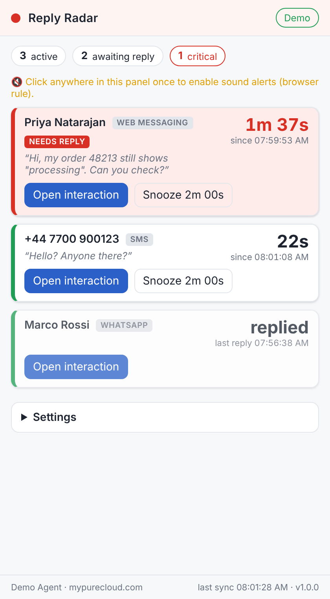

# Reply Radar – unanswered chat & message alerts for Genesys Cloud agents

> **Problem:** an agent is handling several chats / messages at once. A customer writes, the agent is busy in another interaction, the message is never noticed and the customer is left hanging.
>
> **Solution:** a Genesys Cloud **Client Application** that lives in the agent's sidebar, watches the agent's own conversations in real time and, when a customer has been waiting on *that agent* for too long, **pops a toast in the Genesys Cloud UI, flashes a badge on the sidebar icon and beeps**, escalating until the agent replies.



## Why this is a client app and not a Genesys "Script"

Genesys Cloud *Scripts* (Admin → Contact Center → Scripts) render forms inside an interaction and can run data actions when the agent clicks something. They have **no timers, no background execution and no visibility of the agent's other interactions**, so they cannot notice that a chat has gone quiet. The supported way to add behaviour that runs continuously beside the agent UI is a Client Application built with the Genesys Cloud **Client App SDK** (for toasts, badges and "jump to interaction") and the **Platform API Notifications service** (for real-time conversation events). That is exactly what this project is.

## What the agent experiences

| Wait time (default) | What happens |
|---|---|
| customer is waiting < 45 s | Nothing. The panel shows a green row with a live timer. |
| ≥ 45 s (**warn**) | Toast *"💬 Priya is waiting (45s)"* with the customer's last message, a beep, the sidebar icon gets a badge with the number of waiting customers, and the app header pulses red. |
| ≥ 90 s (**critical**) | **Sticky** red toast *"⚠️ Priya has waited 1m 30s"* that stays until dismissed, a louder triple beep, and a reminder every 60 s until the agent replies. |
| customer writes again while the agent is still silent | A fresh alert, even if the level did not change. |
| agent replies | Alert clears, a short green *"Reply sent ✓"* toast replaces the sticky one, badge count drops. |
| agent presses **Snooze** in the panel | That conversation is silent for 2 min, **unless the customer sends another message**, which cancels the snooze. |

Every number above is configurable (see [Configuration](#configuration)). The panel also offers **Open interaction** (jumps the agent straight to that interaction), **Test alert**, and **Re-sync**.

## How it works

```
Genesys Cloud agent UI (browser tab)
└── sidebar iframe: Reply Radar
     ├─ Client App SDK ── postMessage ──► toasts · attention badge · showInteractionDetails
     ├─ OAuth implicit grant (agent's own session, no secrets)
     ├─ REST  GET /api/v2/conversations                     initial + periodic safety-net sync
     ├─ REST  POST /api/v2/conversations/messages/{id}/messages/bulk   confirm who sent each message
     └─ WebSocket  v2.users.{agentId}.conversations          real-time conversation events
            │
            ▼
     ConversationTracker  (src/core/conversationTracker.js)
       waitingSince = max(latest customer message, moment the agent connected)
       awaiting     = agent connected AND no agent message at/after waitingSince
            │
            ▼
     AlertEngine (src/core/alertEngine.js)
       ok → warn → critical, repeat reminders, snooze, resolved
            │
            ▼
     panel (src/ui) · toast · badge · sound
```

Design decisions worth knowing:

- **Queue time is not charged to the agent.** The clock only starts when the interaction is connected to the agent, or when the customer's latest message arrived, whichever is later.
- **Bot or previous-agent replies do not count.** Only an outbound message sent after the agent connected clears the wait, so the agent still owes a greeting after a bot hand-off or a transfer.
- **Read receipts and events never start the clock.** Receipt / Event message types are ignored, so a customer's "read" receipt is not mistaken for a new message.
- **Direction is confirmed, not guessed.** Conversation events only carry a message status; the app first infers direction from it (`received` = customer) and then confirms every message through the bulk message endpoint, which also supplies the preview text.
- **Resilient connection.** The WebSocket channel pings, has a traffic watchdog, reconnects with back-off, recreates the channel when it expired and re-syncs from REST after every reconnect, on focus and every 60 s.
- **Nothing leaves the browser.** No backend, no storage of customer data; the agent's settings live in `localStorage`.

Supported channels: everything that is a Genesys Cloud *message* interaction – Web Messaging, SMS, WhatsApp, Facebook, Instagram, LINE, X, Apple Messages for Business, Open Messaging. (Legacy ACD "web chat" is end-of-life in Genesys Cloud and does not expose message timestamps on the conversation, so it is listed but not timed.)

## Quick start

```bash
npm install
npm run dev            # http://localhost:5173/?demo=1  → preview with synthetic conversations
npm test               # unit tests for the tracker and the alert engine
npm run build          # static site in dist/ – host it anywhere over HTTPS
```

Then follow **[docs/genesys-cloud-setup.md](docs/genesys-cloud-setup.md)** to:

1. host `dist/` (a GitHub Pages workflow is included in `.github/workflows/deploy-pages.yml`),
2. create a **Token Implicit Grant** OAuth client,
3. add a **Client Application** integration whose URL points at the hosted app, with `clientId=…` in the query string,
4. give the agent groups access and ask agents to open the app once after login.

## Configuration

Admins tune defaults for everyone through query parameters on the integration URL; agents can override them for themselves in the panel's **Settings**.

| Query param | Setting | Default | Meaning |
|---|---|---|---|
| `clientId` | – | – | **Required.** OAuth client id (Token Implicit Grant). |
| `warn` | `warnAfterSec` | 45 | Seconds before the first alert. |
| `critical` | `criticalAfterSec` | 90 | Seconds before the sticky alert. |
| `repeat` | `repeatEverySec` | 60 | Reminder interval while critical (`0` = off). |
| `snooze` | `snoozeSec` | 120 | Length of a snooze. |
| `toasts` | `toasts` | 1 | Toast pop-ups on/off. |
| `sound` | `sounds` | 1 | Beeps on/off. |
| `badge` | `badge` | 1 | Sidebar badge on/off. |
| `preview` | `showPreview` | 1 | Show the customer's last message text. |
| `resync` | `resyncEverySec` | 60 | Safety-net REST sync interval. |
| `debug` | `debug` | 0 | Verbose console logging. |
| `demo` | – | 0 | Run with synthetic data, no login (`?demo=1`). |
| `gcUsePopupAuth` | – | – | Set by Genesys (`{{gcUsePopupAuth}}`) when login must use a popup. |

Example integration URL:

```
https://<your-host>/reply-radar/?gcHostOrigin={{gcHostOrigin}}&gcTargetEnv={{gcTargetEnv}}&langTag={{gcLangTag}}&gcUsePopupAuth={{gcUsePopupAuth}}&clientId=0f1e2d3c-...&warn=45&critical=90
```

## Things to know before rollout

- **Agents must open the app once per login.** Genesys Cloud loads a client application the first time the agent clicks it; after that it keeps running in the background (even when another app or interaction is in view). Make "open Reply Radar" part of the login routine, or pin it.
- **Sound needs one click.** Browsers block audio until the user has interacted with the page; the panel shows a hint until that happens. Toasts and the badge work regardless.
- **One browser tab.** Alerts fire in the Genesys Cloud tab that has the app loaded. If an agent uses the desktop app and a browser tab, open Reply Radar in the one they work in.
- **Permissions.** The agent's own conversations are visible to them already; the app only needs the agent to be able to list their conversations (`conversation:communication:view` is in the standard agent roles) and the OAuth client to carry the `conversations`, `notifications` and `users:readonly` scopes.
- **Token lifetime.** The implicit-grant token lasts as long as the OAuth client's *token duration* (default 1 day). After that the panel says *Session expired* – the agent just reopens the app.

## Project layout

```
index.html                      app shell
src/main.js                     boot sequence, wiring, demo mode
src/config.js                   defaults, query overrides, per-agent saved settings
src/core/conversationTracker.js who-is-waiting logic (pure, unit-tested)
src/core/alertEngine.js         escalation / repeat / snooze logic (pure, unit-tested)
src/core/format.js              formatting helpers
src/genesys/clientApp.js        Client App SDK wrapper (toast, badge, jump, lifecycle)
src/genesys/platform.js         Platform API: auth, me, conversations, bulk messages
src/genesys/notifications.js    WebSocket channel with watchdog + reconnect
src/ui/panel.js, styles.css     the sidebar panel
src/sound.js                    Web Audio beeps (no assets to host)
test/                           node:test unit tests
docs/genesys-cloud-setup.md     admin guide
.github/workflows/deploy-pages.yml  GitHub Pages deployment
```

## License

MIT – do what you like, no warranty.
